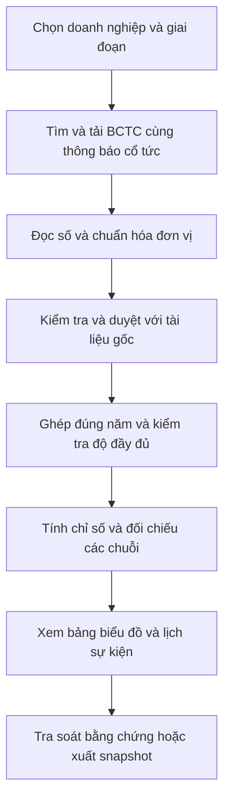

# Giải thích chức năng và dữ liệu của đề tài

**Cập nhật phạm vi 11/10/2026:** [danh mục chức năng v2.0](27-yeu-cau-chuc-nang-va-vi-du.md) là góc nhìn UC lớn→nhỏ cho người theo dõi tài chính/đầu tư; [SRS mục18](22-srs-dac-ta-yeu-cau-phan-mem.md) rút screening. Nội dung nền dưới đây được đọc theo quyết định mới.

**Tài liệu chức năng riêng:** [Yêu cầu chức năng — mục đích, cách sử dụng và ví dụ](27-yeu-cau-chuc-nang-va-vi-du.md) trình bày đủ năm UC lớn với giải thích đơn giản và tình huống minh họa. Tệp hiện tại giữ vai trò giải thích dữ liệu và bối cảnh sử dụng.

**Baseline hướng kết hợp 05/10/2026, được kế thừa trong v3.3:** theo [SRS hiện hành](22-srs-dac-ta-yeu-cau-phan-mem.md), học/triển khai thêm cầu nối LNTT→CFO cho ít nhất một ca, mục tiêu 1–3 sau gate. Đọc [nghiệp vụ](../research-profit-cash-dividend/03-nghiep-vu-va-tu-dien.md) và [ca DHG/VNM](../research-profit-cash-dividend/08-ca-thuc-te-dhg-vnm.md). Minh chứng cần reviewed rows/nguồn, residual/completeness, replay và giờ nhập–duyệt; ghi LNST cạnh LNTT, cổ tức theo profit_year riêng lịch trả. Tuần2 đọc mẫu, tuần4 đo effort, tuần6 cầu nối, tuần8 freeze, tuần10 replay, tuần12–13 kết quả/demo; chưa làm thì ghi pending/not_run. Nhịp báo cáo hai tuần giữ nguyên; kế hoạch v3 là baseline 167 giờ, CR-DIV-02 có dự toán bổ sung riêng.

Ngày cập nhật: **11/10/2026**.

**Đề tài:** Xây dựng hệ thống thu thập, chuẩn hóa và phân tích lợi nhuận, dòng tiền kinh doanh trong mối liên hệ với cổ tức tiền mặt của doanh nghiệp niêm yết Việt Nam.

Tài liệu này giúp người đọc hiểu hệ thống phục vụ ai, làm những việc cụ thể nào, cần lấy những dữ liệu nào và giải quyết vấn đề gì. Đây là mô tả sản phẩm cần xây dựng theo SRS hiện hành; chưa phải xác nhận tất cả chức năng đã hoàn thành.

Nếu cần hiểu ý nghĩa tài chính của các con số trước, đọc [nhập môn tài chính cho dự án](18-nhap-mon-tai-chinh-cho-du-an.md): giải thích bằng ví dụ cửa hàng và phân biệt lợi nhuận, dòng tiền, số dư tiền, cổ tức cùng các tỷ số.

## 1 Hiểu ý tưởng trước khi đọc chức năng

Người theo dõi doanh nghiệp thường cần kiểm tra ba câu hỏi liên quan nhau:

1. Doanh nghiệp có lãi bao nhiêu và lợi nhuận thay đổi thế nào qua các năm?
2. Dòng tiền từ hoạt động kinh doanh có tăng cùng lợi nhuận không, hay lợi nhuận tăng nhưng dòng tiền giảm/âm?
3. Trong bối cảnh đó, mức cổ tức tiền mặt doanh nghiệp công bố cho mỗi năm lợi nhuận tăng, giữ nguyên hay giảm?

Muốn trả lời, người dùng phải đọc nhiều báo cáo và thông báo. Hệ thống gom chúng lại, lấy đúng số, kiểm tra rồi trình bày bảng/biểu đồ có thể mở nguồn để đối chiếu. Kết quả giúp chọn những trường hợp cần tìm hiểu sâu hơn.

**Người dùng chính:** cá nhân theo dõi doanh nghiệp phi tài chính, có kiến thức tài chính cơ bản. Sinh viên/người nghiên cứu có thể xuất dữ liệu để viết báo cáo. Người vận hành kiểm tra kết quả máy đọc và sửa lỗi trước khi công bố.

Ba khái niệm xuất hiện nhiều trong tài liệu:

| Khái niệm | Hiểu đơn giản | Đơn vị trong hệ thống |
|---|---|---|
| Lợi nhuận sau thuế, viết tắt LNST | Kết quả lãi/lỗ sau thuế ghi trong báo cáo của kỳ | Đồng; giao diện có thể đổi sang tỷ đồng để dễ đọc |
| Dòng tiền kinh doanh, viết tắt CFO | Số tiền thuần từ hoạt động kinh doanh ghi trong báo cáo lưu chuyển tiền tệ; có thể dương hoặc âm | Đồng |
| Cổ tức tiền mặt mỗi cổ phiếu, viết tắt DPS | Mức tiền mặt công bố cho một cổ phiếu đủ điều kiện nhận quyền | Đồng/cổ phiếu |

LNST là số theo kế toán; CFO là dòng tiền của hoạt động kinh doanh trong kỳ; số dư tiền là tiền và tương đương tiền tại một ngày. Ba đại lượng này có ý nghĩa khác nhau. DPS lại tính trên **một cổ phiếu**, nên phải trình bày với đơn vị riêng.

## 2 Một câu chuyện để hình dung cách sử dụng

Minh thấy tin doanh nghiệp X tăng lợi nhuận và công bố cổ tức. Minh muốn kiểm tra lịch sử ba năm trước khi quyết định đọc sâu X. Nếu làm thủ công, Minh phải tải BCTC, nhập số, tìm từng thông báo cổ tức và rà các bản sửa.

Trong hệ thống dự kiến, Minh chọn X và giai đoạn 2023–2025. Hệ thống cho biết năm nào đã có BCTC được kiểm tra, năm nào chưa rà đủ cổ tức. Minh xem lợi nhuận và CFO, xem cổ tức theo năm lợi nhuận, rồi bấm vào một con số để mở đúng tài liệu gốc. Minh xuất bản dữ liệu đang xem để lưu cùng báo cáo của mình.

Khi có dữ liệu thiếu, Minh thấy rõ điều gì chưa thể kết luận. Câu chuyện này là tình huống thiết kế, chưa phải kết quả khảo sát người dùng.

## 3 Sử dụng những dữ liệu cụ thể nào

### 3.1 Chọn doanh nghiệp và giai đoạn

Giai đoạn chính là **2023, 2024 và 2025**, ưu tiên doanh nghiệp phi tài chính và BCTC năm đã kiểm toán. Bắt đầu với **3 doanh nghiệp × 3 năm = 9 BCTC năm**, tương ứng **54 ô chỉ tiêu tài chính cần kiểm tra** nếu mỗi báo cáo có đủ sáu trường. Đây là mục tiêu thu thập, chưa phải 54 số đã có.

VNM và DHG là ứng viên pilot vì hồ sơ dự án đã có thông báo cổ tức mẫu. Doanh nghiệp thứ ba chỉ chốt sau khi kiểm tra nguồn, phạm vi báo cáo và lịch sử cổ tức. Mở rộng lên 5–8 doanh nghiệp khi công sức thu thập/kiểm tra cho phép; không lấy một mẫu nhỏ làm kết luận cho toàn thị trường.

| Nhóm dữ liệu | Cụ thể cần gì | Lấy từ đâu |
|---|---|---|
| Nhận diện doanh nghiệp | Tên pháp nhân, mã chứng khoán, mã định danh nội bộ; ISIN (mã định danh chứng khoán quốc tế) nếu có; ngành | Thông tin trên trang quan hệ cổ đông và tài liệu/thông báo chính thức |
| BCTC năm | Bộ báo cáo năm, năm tài chính thật, phạm vi báo cáo và xác nhận loại kiểm toán | Trang quan hệ cổ đông của doanh nghiệp; các danh mục đã thử trong hồ sơ gồm DHG, HPG, VHC |
| Cổ tức tiền mặt | Thông báo quyền, từng đợt, năm lợi nhuận, số tiền/cổ phiếu và các mốc ngày | Thông báo VSDC; trang quan hệ cổ đông và nghị quyết/thông báo doanh nghiệp để đối chiếu |
| Điều chỉnh/hủy | Nội dung sửa lịch, sửa mức tiền, hủy hoặc thay thông báo trước | Công bố điều chỉnh/hủy từ VSDC hoặc doanh nghiệp |
| Thay đổi cơ sở cổ phiếu | Loại sự kiện, ngày hiệu lực, bằng chứng thay đổi cơ sở tính DPS | Công bố liên quan chia/tách cổ phiếu, cổ tức cổ phiếu, cổ phiếu thưởng hoặc phát hành; cần kiểm tra tác động cụ thể |
| Bằng chứng nguồn | File/HTML gốc, URL, ngày công bố, ngày tải, phiên bản và vị trí dòng số | Lưu cùng mỗi lần lấy dữ liệu |

Danh mục nguồn và bằng chứng đã thử nằm ở [sổ nguồn của dự án](10-so-nguon.md). Việc từng tải được một tài liệu của HPG/DHG/VHC không đồng nghĩa đã chọn xong các công ty đó cho toàn bộ mẫu.

### 3.2 Sáu số tài chính bắt buộc

Một bộ BCTC chứa nhiều bảng. Đề tài lấy **sáu số dưới đây**, không chỉ ghi chung chung “dữ liệu báo cáo tài chính”. Tên dòng có thể thay đổi nhẹ giữa các mẫu báo cáo; phải xác nhận đúng ý nghĩa và cột năm.

| Dữ liệu | Dòng cần tìm và bảng nguồn | Kỳ lấy số | Dùng để làm gì |
|---|---|---|---|
| LNST tổng | Dòng “Lợi nhuận sau thuế thu nhập doanh nghiệp” trong báo cáo kết quả hoạt động kinh doanh | Cả năm tài chính | Xem mức/chênh lệch lợi nhuận; tính CFO/LNST; đối chiếu với DPS |
| CFO | Dòng “Lưu chuyển tiền thuần từ hoạt động kinh doanh” trong báo cáo lưu chuyển tiền tệ | Cùng cả năm với LNST | Xem biến động dòng tiền; tính CFO/LNST; tìm năm lợi nhuận và CFO khác chiều |
| Tiền và tương đương tiền | Dòng “Tiền và các khoản tương đương tiền” trong bảng cân đối kế toán | Tại ngày cuối năm tài chính | Xem số dư tiền và tính tiền/tổng tài sản |
| Tổng tài sản | Dòng “Tổng cộng tài sản” trong bảng cân đối kế toán | Cùng ngày cuối năm | Làm mẫu số cho tỷ lệ tiền và tỷ lệ nợ phải trả; kiểm tra cân đối |
| Tổng nợ phải trả | Dòng “Nợ phải trả”, lấy tổng mục, trong bảng cân đối kế toán | Cùng ngày cuối năm | Tính nợ phải trả/tổng tài sản; kiểm tra cân đối |
| Tổng vốn chủ sở hữu, viết tắt VCSH | Dòng “Vốn chủ sở hữu”, lấy tổng mục, trong bảng cân đối kế toán | Cùng ngày cuối năm | Hiển thị trong bảng dữ liệu; kiểm tra tài sản xấp xỉ nợ phải trả + VCSH theo độ làm tròn của nguồn |

**Điểm cần đọc đúng:** LNST tổng không thay bằng riêng LNST của cổ đông công ty mẹ khi tính với CFO tổng. Nợ phải trả gồm nhiều nghĩa vụ, không đồng nghĩa toàn bộ là nợ vay. VCSH là phần bắt buộc để hiển thị/kiểm tra dữ liệu; chưa đưa thêm ROE vào chức năng lõi.

### 3.3 Mỗi số phải đi kèm thông tin gì

Một con số như “120.000” chưa đủ để phân tích. Hệ thống phải biết nó là số gì, thuộc công ty/năm nào và được ghi theo đơn vị nào.

| Thông tin kèm theo | Ví dụ giả định | Tác dụng |
|---|---|---|
| Doanh nghiệp và tên chỉ tiêu | X; LNST tổng | Không lẫn công ty hoặc nhầm chỉ tiêu |
| Kỳ bắt đầu/kết thúc hoặc ngày chốt số | 01/01/2024–31/12/2024 với LNST/CFO; 31/12/2024 với tài sản/tiền | Không lấy số quý hoặc đầu năm thay cho số năm/cuối năm |
| Phạm vi BCTC | Hợp nhất | Đảm bảo các số dùng chung phạm vi |
| Giá trị và đơn vị gốc | 120.000; triệu đồng | Giữ bằng chứng trước khi quy đổi |
| Giá trị chuẩn hóa | 120.000.000.000 đồng | Dùng thống nhất trong phép tính |
| File và vị trí | BCTC X năm 2024; trang 5, dòng LNST, cột năm 2024 | Mở đúng chỗ để kiểm chứng |
| Phiên bản và trạng thái kiểm tra | Bản tải tại một mốc; đã duyệt | Không dùng số chưa kiểm tra hoặc ghi đè mất bản cũ |

**BCTC hợp nhất** phản ánh nhóm công ty; **BCTC riêng** phản ánh một pháp nhân. Hệ thống duy trì chuỗi năm cùng phạm vi; không ghép CFO hợp nhất với LNST riêng. Nếu doanh nghiệp không lập hợp nhất và đã xác nhận, dùng báo cáo cấp doanh nghiệp với nhãn rõ ràng.

### 3.4 Các trường cụ thể của thông báo cổ tức

| Trường cần lấy | Ý nghĩa | Vì sao cần |
|---|---|---|
| Doanh nghiệp, mã chứng khoán/ISIN | Ai công bố, cổ phiếu nào nhận quyền | Ghép đúng công ty/chứng khoán |
| Mã thông báo và loại sự kiện | Cổ tức tiền mặt, cổ tức cổ phiếu, điều chỉnh hoặc hủy | Phân biệt loại, nhận diện cùng một thông báo |
| Số tiền trên mỗi cổ phiếu | Ví dụ giả định 1.000 đồng/cổ phiếu | Là số DPS đưa vào phân tích |
| Tỷ lệ và mệnh giá nếu nguồn ghi theo % | Ví dụ giả định 10% trên mệnh giá 10.000 đồng | Quy đổi 0,10 × 10.000 = 1.000 đồng/cổ phiếu; không hiểu là lợi suất theo giá thị trường |
| Năm lợi nhuận | Ví dụ cổ tức thuộc năm 2024 | Ghép với BCTC 2024 dù thông báo đăng năm 2025 |
| Đợt/tạm ứng/phần còn lại | Ví dụ đợt 1 hoặc thanh toán còn lại | Theo dõi nhiều đợt, kiểm tra còn thiếu đợt nào |
| Ngày công bố | Khi thông báo xuất hiện theo nguồn | Lập lịch sử công bố; khác ngày hệ thống tải |
| Ngày đăng ký cuối cùng | Mốc chốt danh sách người nhận quyền | Hiển thị lịch sự kiện đúng nội dung nguồn |
| Ngày thanh toán theo lịch | Mốc doanh nghiệp thông báo sẽ trả | Hiển thị lịch, chưa chứng minh thực trả |
| Quan hệ với thông báo trước | Sửa lịch, sửa tiền, thay thế hoặc hủy thông báo nào | Chọn bản có hiệu lực và tránh cộng trùng |
| Cơ sở cổ phiếu | Mức tiền tính cho cổ phiếu trước/sau thay đổi nào | Kiểm tra có thể cộng/so sánh DPS hay chưa |
| Nguồn, vị trí nội dung, phiên bản và trạng thái duyệt | URL, đoạn thông báo, ngày lấy, đã kiểm tra hay đang chờ | Kiểm chứng và lưu lịch sử |

Số lượng thông báo không cố định là một thông báo/công ty/năm: một năm có thể có nhiều đợt, một thông báo có thể gộp nhiều năm và có thêm bản sửa. Hệ thống phải rà các đợt liên quan năm lợi nhuận, kể cả công bố ở năm sau.

**Xác nhận đã thực trả** chỉ thêm khi có bằng chứng riêng. Việc ngày thanh toán đã qua không đủ để đổi trạng thái thành “đã trả”. Nghị quyết phê duyệt và thông báo quyền của cùng đợt là các tài liệu đối chiếu, không cộng hai lần như hai khoản cổ tức.

### 3.5 Dữ liệu về độ đầy đủ và lịch sử

Hệ thống lưu công ty–năm–phạm vi cần tìm, nguồn/trang/khoảng ngày đã rà, số đã kiểm tra, phần thiếu, người xác nhận và thời điểm chốt dữ liệu. Trạng thái riêng cho BCTC và cổ tức gồm **đủ tại mốc kiểm tra**, **mới có một phần**, **chưa xác định**.

Ví dụ: đã có sáu số BCTC 2025 nhưng mới tìm được một đợt cổ tức 2025. Khi đó BCTC có thể đủ, cổ tức vẫn chưa đủ. Có số chưa có nghĩa đã có toàn bộ lịch sử năm đó.

## 4 Các chức năng chính theo UC lớn

Cấu trúc cập nhật 11/10/2026 theo [SRS v3.3](22-srs-dac-ta-yeu-cau-phan-mem.md). Các bước thu thập, trích xuất, chuẩn hóa và duyệt được gom vào UC quản lý hồ sơ dữ liệu. [Bộ nghiên cứu ba chức năng](../research-dividend-functions/README.md) có thiết kế, khả thi, ca thật và minh chứng đã chạy; phần tích hợp ứng dụng mới đề xuất.

### 4.1 BUC01 — Khai thác và quản lý dữ liệu doanh nghiệp

Đầu vào: doanh nghiệp/kỳ và tài liệu từ nguồn chính thức. Xử lý: thiết lập tập → thu/cập nhật → trích/chuẩn hóa → kiểm tra/duyệt → lưu phiên bản và độ đầy đủ. Đầu ra: hồ sơ có số liệu được duyệt, nguồn và mục còn thiếu. Giải quyết việc tìm/nhập lặp lại và nhầm số/kỳ/đơn vị; hoàn thành khi dữ liệu phân tích được, không chỉ tải được file. Luồng nhỏ UC01–04/08 được giữ trong mục17 SRS.

### 4.2 BUC02 — Phân tích tài chính và nền tảng tiền mặt

Đầu vào: LNST/CFO, tiền/nợ/tài sản và các dòng mở rộng được chọn. Xử lý: xu hướng/tỷ số → cầu nối CFO → CFO sau CAPEX/phân phối khi đủ dữ liệu. Đầu ra: bảng đối chiếu có công thức/nguồn và vấn đề cần đọc thêm. G02 mới cho thấy CFO dương vẫn có thể không bao phủ các khoản chi; ca DHG có phép tính đã chạy, chưa UI end-to-end. Không gọi số dư là dự báo cắt cổ tức.

### 4.3 BUC03 — Phân tích lịch sử chính sách và quyền cổ tức

Đầu vào: thông báo/đợt/năm lợi nhuận, coverage, chuỗi sửa/hủy và ledger cổ phiếu mới. Xử lý: xác định hiệu lực → tổng theo năm → kiểm basis → so DPS gốc/tham chiếu. Đầu ra: lịch sử với giải thích hoặc chưa đủ cơ sở. Không cộng cổ phiếu vào tiền mặt nhưng giữ sự kiện để tránh diễn giải sai DPS. G03 mới có ca FPT về quyền 20:3/phần lẻ; chưa tự xác nhận mọi ngày basis hay thực nhận.

### 4.4 BUC04 — Đối chiếu dữ liệu tài chính doanh nghiệp

Đầu vào: doanh nghiệp/kỳ/scope tự chọn và snapshot. Xử lý: kiểm tương thích/độ đầy đủ → xem bảng và biểu đồ → đối chiếu số/nguồn. Đầu ra: dữ liệu cùng cơ sở hoặc lý do chưa so được. FR29/30 và D09/10 đã rút theo CR-AN-03; bảng nhiều doanh nghiệp trong UC-F03 là bổ sung cần đặc tả.

### 4.5 BUC05 — Lưu và tiếp tục phân tích

Đầu vào: kết quả phân tích/đối chiếu và nhận xét người dùng. Xử lý: tra soát nguồn → ghi luận điểm/câu hỏi cần xử lý → lưu snapshot → xuất/replay. Đầu ra: hồ sơ lập luận mở lại được sau khi dữ liệu hiện hành đổi. G01 mới thêm note/task/dossier; FR31/34/35 là nền provenance và snapshot. Theo dõi ảnh hưởng thay đổi tự động là giai đoạn sau.

## 5 Ví dụ xuyên suốt từ đầu vào tới kết quả

**Toàn bộ số của X dưới đây là giả định để giải thích chức năng.** Giả sử hai BCTC cùng phạm vi, số đã kiểm tra, cổ tức đã rà đủ và cơ sở cổ phiếu tương thích.

| Dữ liệu | 2023 | 2024 | Đơn vị |
|---|---|---|---|
| LNST tổng | 100 | 120 | Tỷ đồng |
| CFO | 90 | 40 | Tỷ đồng |
| Tiền và tương đương tiền | 120 | 100 | Tỷ đồng |
| Tổng tài sản | 1.000 | 1.100 | Tỷ đồng |
| Tổng nợ phải trả | 400 | 550 | Tỷ đồng |
| Tổng VCSH | 600 | 550 | Tỷ đồng |
| DPS công bố đủ | 1.000 | 1.500 | Đồng/cổ phiếu |

Hệ thống xử lý và trả lời cụ thể:

| Kết quả | Cách tính | Người dùng hiểu được gì |
|---|---|---|
| LNST 2024 tăng 20 tỷ, tương ứng 20% | 120 − 100; 20 / 100 × 100% | Lợi nhuận tăng |
| CFO 2024 giảm 50 tỷ | 40 − 90 = −50 | Dòng tiền kinh doanh giảm dù lợi nhuận tăng |
| CFO/LNST từ 0,90 xuống khoảng 0,33 lần | 90 / 100; 40 / 120 | CFO thấp hơn so với LNST theo tỷ số này |
| Tiền/tài sản từ 12% xuống khoảng 9,09% | 120 / 1.000; 100 / 1.100 | Tiền chiếm tỷ trọng thấp hơn trong tài sản |
| Nợ phải trả/tài sản từ 40% lên 50% | 400 / 1.000; 550 / 1.100 | Nợ phải trả chiếm tỷ trọng cao hơn |
| DPS tăng 500 đồng, tương ứng 50% | 1.500 − 1.000; 500 / 1.000 × 100% | Mức cổ tức tiền mặt công bố tăng trên cùng cơ sở cổ phiếu |

Nhận xét có thể xuất: **“Năm 2024, LNST và DPS công bố tăng, trong khi CFO giảm; CFO/LNST giảm từ 0,90 xuống khoảng 0,33 lần.”** Mỗi phần nhận xét gắn với số và nguồn tương ứng.

Nếu mới tìm được 1.500 đồng/cổ phiếu nhưng chưa rà đủ các đợt 2024, hệ thống chỉ gọi đó là **tổng phần đã quan sát**, chưa xuất nhận xét DPS năm tăng 50%. Nếu BCTC 2024 là phạm vi khác 2023, hệ thống chưa nối chuỗi như ví dụ.

Hệ thống không lấy 40 tỷ CFO chia cho 1.500 đồng/cổ phiếu để gọi là khả năng trang trải cổ tức: hai đại lượng có đơn vị và ý nghĩa khác nhau. Muốn nghiên cứu tổng tiền chi trả cần thêm dữ liệu tương ứng, chưa thuộc phép tính lõi.

## 6 Luồng hoạt động và các màn hình người dùng cần thấy

| Màn hình dự kiến | Nội dung người dùng thấy |
|---|---|
| Hồ sơ doanh nghiệp | Tên/mã, giai đoạn, phạm vi, bảng sáu số và mức đầy đủ của BCTC/cổ tức |
| Phân tích | Các đường LNST–CFO, tỷ số, chuỗi DPS, chênh lệch và dữ liệu người dùng chọn |
| Sự kiện cổ tức | Các đợt theo năm lợi nhuận và lịch công bố/chốt quyền/thanh toán, bản sửa/hủy |
| Kiểm chứng | Số đầu vào, công thức, nguồn và vị trí bằng chứng; xuất snapshot |
| Kiểm tra dữ liệu cho người vận hành | Số đang chờ duyệt, vấn đề cần sửa, trang gốc và lịch sử thay đổi |

Đây là cách nhóm nội dung giao diện, chưa yêu cầu năm ứng dụng riêng hoặc hệ thống nhiều tài khoản. Chức năng demo/đánh giá trong SRS dùng các luồng này để chứng minh chạy đúng trên dữ liệu thật và tình huống lỗi.

## 7 Vấn đề được giải quyết và phép đo ích lợi

| Vấn đề | UC lớn | Minh chứng cần có |
|---|---|---|
| Tìm/nhập số lặp, sai kỳ/đơn vị/scope | BUC01 | Giờ gồm review, lỗi đối chiếu nguồn và coverage |
| Chỉ nhìn lợi nhuận/CFO dương nên bỏ sót nhu cầu tiền | BUC02 | Ca bao phủ khoản chi và tra soát đúng định nghĩa/chủ thể |
| DPS thay đổi nhưng nhầm chính sách vì basis hoặc thiếu thông báo | BUC03 | Ca raw/reference, partial và quyền/sửa/hủy |
| Muốn đối chiếu dữ liệu doanh nghiệp đã chọn | BUC04 | Đúng kỳ/scope/đơn vị; thiếu có lý do |
| Nhận xét không kiểm lại được hoặc mất sau update | BUC05 | Dossier có nguồn, bản freeze và replay đúng |

Các mục trên là lợi ích phải đo bằng tác vụ; 20 kiểm tra prototype mới chứng minh phép tính/quy tắc. Chưa có kết quả thử người dùng hay hiệu quả đầu tư.

## 8 Phạm vi hiện tại và hướng tốt nghiệp

**Project hiện tại:** thu thập, kiểm tra, ghép và phân tích lịch sử. Có thể chỉ ra “LNST tăng nhưng CFO giảm”, “DPS công bố tăng trong bối cảnh CFO giảm” hoặc “năm này chưa đủ dữ liệu để so sánh”.

**Ngoài baseline sáu trường, bổ sung theo ca CR-DIV-02:** CAPEX/phân phối thực chi và ledger sự kiện cổ phiếu có điều kiện. Chưa mở các trường này cho toàn tập.

**Chưa đưa vào chức năng lõi:** giá cổ phiếu/lợi suất cổ tức theo giá thị trường, mọi quý hoặc số liệu 12 tháng gần nhất, doanh thu, lợi nhuận mỗi cổ phiếu (EPS), nợ vay, vốn lưu động toàn tập, tỷ suất lợi nhuận trên VCSH (ROE) hoặc tỷ lệ DPS/EPS. Chỉ bổ sung khi có câu hỏi cụ thể và dữ liệu/định nghĩa phù hợp. Sáu số hiện tại chưa đủ để giải thích sâu nguyên nhân CFO thay đổi hoặc khẳng định tiền có thể phân phối tại công ty mẹ.

**Hướng tốt nghiệp cập nhật sau nghiên cứu lần hai:** ưu tiên nhận biết dữ liệu nào thay đổi giữa các phiên bản và ratio/tổng DPS/case nào bị ảnh hưởng, có review và giữ snapshot cũ. Dự đoán giảm cổ tức là tùy chọn khi có nhiều năm/doanh nghiệp, nhãn đủ và thông tin đúng thời điểm; phải so baseline và tách thông báo tương lai. Project hiện tại chưa cung cấp xác suất hay khuyến nghị mua/bán. [Quyết định cuối](20-nghien-cuu-lan-hai-va-chot-de-tai.md).

## 9 Đối chiếu với tài liệu triển khai

- [SRS v3.3 hiện hành](22-srs-dac-ta-yeu-cau-phan-mem.md): 5 BUC, FR còn hoạt động và D01–D08/D11–D12; [nhu cầu nền](02-de-tai-va-srs.md) giữ PF/AN làm năng lực phân rã.
- [Từ điển tài chính và sự kiện](12-kien-thuc-tai-chinh-va-tu-dien.md): ý nghĩa chính xác của các trường.
- [Phương pháp thu thập và kiểm tra](11-phuong-phap-thu-thap-va-xu-ly.md): nguồn, bước tự động và phần cần review.
- [Quy tắc ghép và phép phân tích](13-ghep-co-tuc-va-phan-tich.md): xử lý cổ tức, điều kiện tính và giới hạn.
- [Câu chuyện nền và trình bày ý tưởng](16-y-tuong-va-cau-chuyen-nguoi-dung.md): nội dung để trao đổi với giảng viên.

Hồ sơ dự án đã có prototype thu BCTC và các ví dụ trích số/thông báo, nhưng chưa có ứng dụng hoàn chỉnh hay lịch sử ba năm đã ghép đầy đủ. Tài liệu này giải thích phạm vi cần thực hiện, không thay các bằng chứng nghiệm thu bằng số minh họa.
